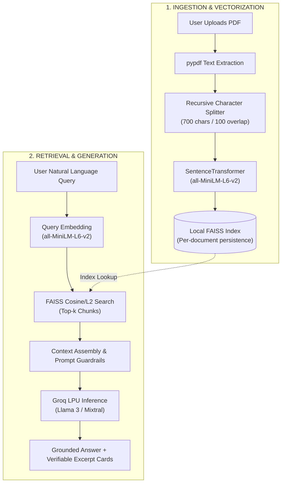

<div align="center">

# 📄 DocQA
### Production-Ready RAG Document Q&A Assistant

**Transform static PDFs into interactive, verifiable knowledge bases with zero-hallucination semantic search.**

[](https://python.org)
[](https://djangoproject.com)
[](https://groq.com)
[](https://github.com/facebookresearch/faiss)
[](https://huggingface.co/sentence-transformers/all-MiniLM-L6-v2)
[](LICENSE)

<br />

[Features](#-key-features) • [Why DocQA?](#-the-problem-hallucinations-vs-grounded-qa) • [RAG Pipeline](#-architecture--rag-pipeline) • [Quick Start](#-quick-start) • [Tech Stack](#-technical-stack) • [Configuration](#-pipeline-parameters)

</div>

---

## ⚡ The Problem: Hallucinations vs. Grounded Q&A

Generic LLM chats often invent facts, misquote data, or fabricate citations when answering technical or dense documents. **DocQA** strictly enforces source-grounded generation:

| Metric / Capability | Raw LLM Query | 📄 DocQA RAG Pipeline |
| :--- | :--- | :--- |
| **Factual Grounding** | ⚠️ Relies on training memory (prone to hallucinations) | 🛡️ **Strict context confinement** (only answers from document) |
| **Verification** | ❌ No source citations or page links | ✅ **Verifiable excerpts** displayed beside every response |
| **Private / Fresh Data** | ❌ Cannot access private notes or latest PDFs | ✅ **Instant local ingestion** for custom PDFs & research papers |
| **Response Latency** | ⏳ 3–8s standard cloud APIs | ⚡ **Sub-second answers** via Groq LPUs |
| **Cost & Privacy** | 💸 Heavy token costs sending entire documents | 🔒 **Local embeddings + local FAISS index** (only top chunks sent to LLM) |

---

## ✨ Key Features

- 📑 **Drag-and-Drop Ingestion**: Parse multi-page PDFs cleanly using `pypdf` with automated text sanitization.
- 🧩 **Optimized Overlapping Chunks**: LangChain-powered chunking (700 characters, 100 character overlap) to preserve semantic continuity across paragraph boundaries.
- ⚡ **Local Dense Retrieval**: Generates 384-dimensional dense vectors using `sentence-transformers/all-MiniLM-L6-v2` stored in document-isolated FAISS indexes.
- 🚀 **Blazing Fast Groq Inference**: Integrates Groq’s LPU infrastructure for near-instant responses with low token overhead.
- 🔍 **Source Transparency**: Each answer provides clickable document excerpt cards showing the exact context blocks used for the generation.
- 🧪 **Notebook-Verified Architecture**: Prototype & hyperparameter validation notebook included (`notebooks/rag_experiments.ipynb`).

---

## 🧠 Architecture & RAG Pipeline



---

## 🛠️ Technical Stack

| Layer | Technology | Rationale |
| :--- | :--- | :--- |
| **Web Framework** | **Django 5.x / Python 3.11** | Robust ORM, built-in security, and clean MVC architecture |
| **Vector Index** | **FAISS (CPU)** | Blazing fast nearest-neighbor search with zero cloud database fees |
| **Embedding Model** | **`all-MiniLM-L6-v2`** | 384-dim local embeddings; fast CPU execution with high semantic quality |
| **Text Chunking** | **LangChain Text Splitters** | Boundary-aware recursive splitting preventing mid-sentence truncation |
| **LLM Engine** | **Groq API** | Ultra-low latency token generation on dedicated LPU hardware |
| **PDF Extraction** | **pypdf** | Lightweight, pure-Python document parsing with zero binary bloat |

---

## 📂 Project Structure

```text
ragqa-assistant/
├── manage.py                   # Django CLI utility
├── requirements.txt            # Locked project dependencies
├── .env.example                # Sample environment configuration
├── ragqa/                      # Django project configuration
│   ├── settings.py             # App configurations, static/media roots
│   ├── urls.py                 # Core routing
│   └── wsgi.py
├── qa/                         # Primary application
│   ├── models.py               # Document & Query models
│   ├── views.py                # Upload, Indexing, and Q&A controllers
│   ├── rag_utils.py            # FAISS indexing, embedding & Groq LLM pipelines
│   ├── forms.py                # File upload forms & validations
│   └── templates/qa/           # UI views (Upload, Q&A dashboard, citations)
│       ├── base.html
│       ├── upload.html
│       └── ask.html
├── notebooks/
│   └── rag_experiments.ipynb  # Benchmarking & validation experiments
└── media/                      # Uploaded PDFs & local vector indices (gitignored)
```

---

## ⚙️ Pipeline Parameters

| Parameter | Default Value | Description |
| :--- | :--- | :--- |
| **`CHUNK_SIZE`** | `700` chars | Balances semantic completeness with vector specificity |
| **`CHUNK_OVERLAP`** | `100` chars | Prevents losing context across chunk splits |
| **`EMBEDDING_MODEL`** | `all-MiniLM-L6-v2` | Compact, 384-dimensional dense semantic vectors |
| **`TOP_K_RETRIEVAL`** | `3` chunks | Top most relevant document chunks fed into the LLM context |
| **`LLM_TEMPERATURE`** | `0.1` | Low temperature to enforce strict factual recall |

---

## 🚀 Quick Start

### 1. Prerequisites
- **Python 3.11+**
- A free **[Groq API Key](https://console.groq.com)**

### 2. Clone & Setup Virtual Environment
```bash
git clone https://github.com/aniket25042005/ragqa-assistant.git
cd ragqa-assistant

# Create virtual environment
python -m venv venv

# Activate virtual environment
# Windows:
venv\Scripts\activate
# macOS / Linux:
source venv/bin/activate
```

### 3. Install Dependencies
```bash
pip install -r requirements.txt
```

### 4. Configure Environment Variables
Create a `.env` file in the project root:
```bash
cp .env.example .env   # Or create .env manually
```
Add your Groq API key:
```env
GROQ_API_KEY=your_groq_api_key_here
SECRET_KEY=django-insecure-your-secret-key-here
DEBUG=True
```

### 5. Initialize Database & Run Server
```bash
python manage.py migrate
python manage.py runserver
```

Open your browser at **`http://127.0.0.1:8000/`** to start asking questions!

---

## 📖 How to Use

1. **Upload Document**: Select any PDF (research paper, book chapter, technical manual).
2. **Automatic Indexing**: DocQA parses the text, computes embeddings, and builds a dedicated FAISS index.
3. **Ask Questions**: Type queries in plain English (e.g., *"What methodology was used in chapter 3?"*).
4. **Inspect Citations**: Review the synthesized answer alongside the exact document excerpts.

---

## 🔮 Roadmap

- [ ] Multi-document querying across entire folders
- [ ] Multi-turn conversational memory (chat history)
- [ ] Additional format ingestion (`.docx`, `.txt`, `.md`)
- [ ] Hybrid search (BM25 lexical + FAISS dense retrieval)
- [ ] Dockerized single-command deployment (`docker-compose.yml`)

---

## 📄 License

Distributed under the **MIT License**. See [`LICENSE`](LICENSE) for details.

---

## 🙋 Author

**Aniket Kumar Singh**  
*B.Tech CSE (AI & ML) — JSS Academy of Technical Education*

[](https://github.com/aniket25042005)
[](https://www.linkedin.com/in/aniket-kumar-singh-70941a277/)
